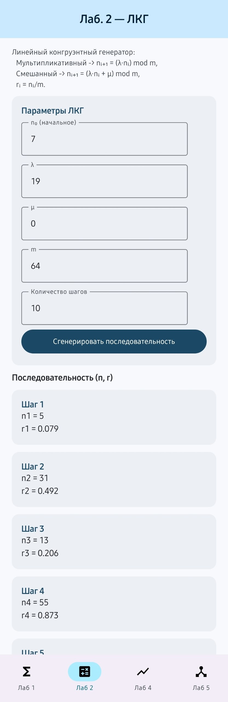
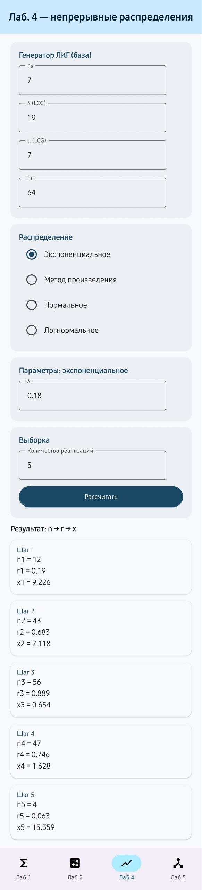
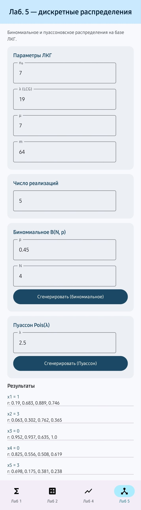

# Systems Modelling — Kotlin Multiplatform App

An Android + iOS app for **generating random numbers and sampling probability distributions**,
built from a single Kotlin codebase with **Kotlin Multiplatform** and **Compose Multiplatform**.

It started as a set of university labs for the *Systems Modelling* course. Each lab is a screen
where you enter parameters, run the generator and see every intermediate step, not just the answer.

| Lab 2 — LCG | Lab 4 — continuous | Lab 5 — discrete |
|---|---|---|
|  |  |  |

## What's inside

| Lab | Topic | Methods |
|---|---|---|
| 1 | Random values from bit sequences | Segment division method, combination (octal) method |
| 2 | Pseudo-random number generation | Linear congruential generator: multiplicative `nᵢ₊₁ = (λ·nᵢ) mod m` and mixed `nᵢ₊₁ = (λ·nᵢ + μ) mod m` |
| 4 | Continuous distributions | Normal (sum of 12 uniforms), log-normal, exponential, product method (Erlang) |
| 5 | Discrete distributions | Poisson, binomial |

Sample statistics (mean, mean square) are shown so you can compare the generated values
with the theoretical ones.

## Architecture

```
composeApp/src/
├── commonMain/          # shared code for Android and iOS
│   ├── lab1/ lab2/ lab4/ lab5/   # generators and use cases (pure Kotlin)
│   ├── statistics/               # sample statistics
│   └── ui/                       # Compose Multiplatform screens, navigation, theme
├── androidMain/         # Android entry point
└── iosMain/             # iOS entry point
iosApp/                  # Xcode project
```

The math lives in plain Kotlin classes with no UI dependencies, so it is shared as-is and easy to test.

## Tech stack

Kotlin · Kotlin Multiplatform · Compose Multiplatform · Material 3 · Gradle (KTS)

## Tests

The generators are covered by unit tests in `commonTest` (known sequences, value ranges, edge cases):

```bash
./gradlew :composeApp:testDebugUnitTest
```

## Run it

**Android:** open the project in Android Studio and run `composeApp`, or

```bash
./gradlew :composeApp:assembleDebug
```

**iOS:** open `iosApp/iosApp.xcodeproj` in Xcode and run.

## Roadmap

- [x] Unit tests for every generator (`composeApp/src/commonTest`)
- [ ] Histogram of generated samples vs. the theoretical density
- [ ] APK in GitHub Releases
